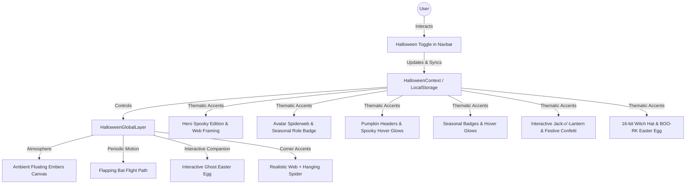
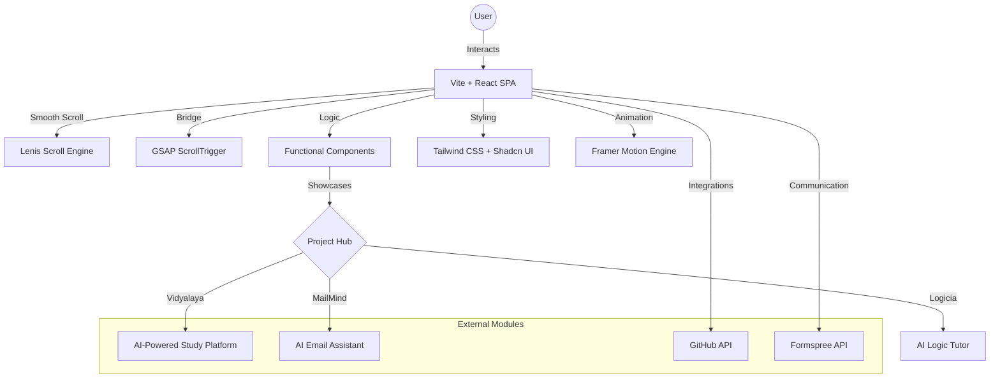
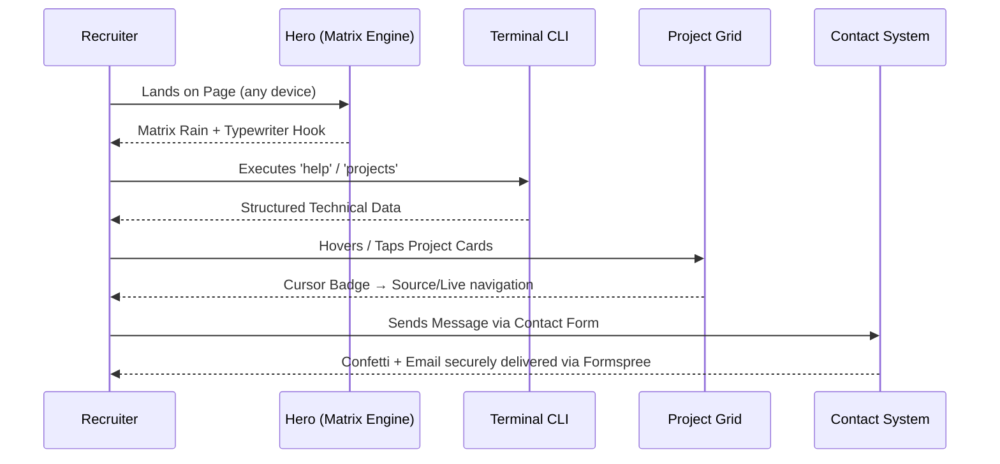

<a id="readme-top"></a>

# 🚀 Durga Vara Prasad's Professional Engineering Portfolio

**A High-Performance, Neo-Brutalist Digital Identity & Engineering Showcase**

[](https://vitejs.dev/)
[](https://reactjs.org/)
[](https://www.typescriptlang.org/)
[](https://tailwindcss.com/)
[](https://www.framer.com/motion/)
[](https://ui.shadcn.com/)
[](https://github.com/darkroomengineering/lenis)

[**Live Demo**](https://vara-s-portfolio.vercel.app/) • [**Source Code**](https://github.com/VARA4u-tech/Vara-s--Portfolio) • [**Request Collaboration**](mailto:durgavaraprasadpappuri13@gmail.com)

---

## 📌 Project Overview

### **The Problem Statement**

In a crowded tech landscape, a standard PDF resume often fails to convey the depth of a developer's engineering capabilities, design sensibility, and problem-solving approach. Recruiters need a high-fidelity, interactive platform to verify a candidate's skills in real-time.

### **The Solution**

This portfolio is a **World-Class Digital Identity** built to bridge the gap between static resumes and live production code. It serves as a centralized hub for multiple high-impact projects, showcasing expertise in AI integration, full-stack architecture, and premium UI/UX design.

### **Core Objectives & Business Value**

- **Transparency**: Direct links to original repositories and live deployments.
- **Interactivity**: Custom-built Terminal CLI, Matrix-style visual engines, living PixelPet mascot, and intelligent project card interactions.
- **Seasonal Experience**: Modular interactive Halloween theme system with toggleable state, physics-based micro-interactions, and synthesized audio.
- **Conversion**: Seamless lead generation via integrated professional contact forms (Formspree).
- **Quality**: Demonstrating MNC-level code standards, documentation, and performance.

---

## 🎃 Interactive Seasonal Architecture (Halloween Edition)

The portfolio includes a **modular, premium seasonal experience** designed to celebrate Halloween without cluttering the interface or compromising professional branding.



### **Halloween Features Highlights**

- **Modular Seasonal Toggle ([`HalloweenToggle.tsx`](src/components/halloween/HalloweenToggle.tsx))**: Positioned in the navbar alongside `PetToggle` and `SoundToggle`. Users can toggle Halloween mode on/off anytime with instant state persistence in `localStorage`.
- **Realistic Spiderwebs with Physics-Based Spiders ([`SpiderWeb.tsx`](src/components/halloween/SpiderWeb.tsx))**: Crafted SVG catenary arcs anchored to container corners. Includes an interactive spider that lowers down smoothly when hovered/tapped and retracts up on mouse leave.
- **Interactive Floating Ghost ([`FloatingGhost.tsx`](src/components/halloween/FloatingGhost.tsx))**: Drifts with sinusoidal float physics. When hovered or clicked, the ghost gets playfully spooked, blushes, plays an inline Web Audio chime, and pops a celebratory speech bubble (_"BOO! 👻"_, _"TRICK OR TREAT! 🎃"_).
- **Soaring Silhouette Bats ([`FlyingBats.tsx`](src/components/halloween/FlyingBats.tsx))**: Flapping bats soaring across the screen in organic Bézier paths every 24–30s (`pointer-events-none`).
- **Carved Jack-o'-Lanterns ([`JackOLantern.tsx`](src/components/halloween/JackOLantern.tsx))**: Illustrated pumpkins with realistic flickering candlelight keyframes (`#FF7518` to `#FFD54F`). Glows brighter on hover and winks on click.
- **Ambient Floating Embers ([`SpookyAtmosphere.tsx`](src/components/halloween/SpookyAtmosphere.tsx))**: Canvas-accelerated atmospheric ember motes drifting upward with wave motion, capped at 24 particles for 60fps performance.
- **Mascot Costume Easter Egg ([`PixelPet.tsx`](src/components/PixelPet.tsx))**: The living dog mascot wears a custom 16-bit pixel witch hat and barks **"BOO-RK! 🎃"**.
- **Synthesized Web Audio Effects ([`useSoundEffects.ts`](src/hooks/useSoundEffects.ts))**: Added `playSpookyBoo()` and `playPumpkinGlow()` using inline oscillator synthesis (zero external audio dependencies).
- **Accessibility & Performance**: Fully honors `prefers-reduced-motion` and uses `pointer-events-none` on all overlays to ensure buttons, links, and forms remain unblocked.

---

## 🏗 System Architecture

The portfolio follows a modular, component-based architecture designed for extreme performance and scalability.



---

## ⚙️ Development Methodology

### **Agile Implementation**

The project was developed using a disciplined **Agile (Scrum)** approach:

- **Sprint 0: Architecture & Foundation**: Selection of Vite for 300ms HMR, Shadcn UI for atomic design patterns, and TypeScript paths without deprecated `baseUrl`.
- **Sprint 1: Core Engine**: Implementation of the Matrix rain canvas and the custom Terminal CLI.
- **Sprint 2: Integration Phase**: Connecting GitHub contribution graphs and building the dynamic project grid.
- **Sprint 3: Polish & UX**: Adding sound effects (`useSoundEffects`), haptic-like interactions, and responsiveness audits.
- **Sprint 4: Interactive Project Cards**: Engineered the split-zone cursor-following hover badge system and full mobile/tablet optimisation pass.
- **Sprint 5: Cross-Device Matrix Rain**: Extended Matrix rain to all screen sizes with a three-tier performance model and GPU compositing.
- **Sprint 6: Seasonal Theming & Atmosphere**: Engineered the modular Halloween design system, SVG micro-interactions, and synthesized audio engine.

---

## ✨ Features Breakdown

| Feature                      | Description                                                          | Implementation Detail                                                                                                                                                                                                                       |
| :--------------------------- | :------------------------------------------------------------------- | :------------------------------------------------------------------------------------------------------------------------------------------------------------------------------------------------------------------------------------------ |
| **Interactive Halloween**    | Modular seasonal experience with toggleable switch in navbar         | Encapsulated in `src/components/halloween/`. Uses `HalloweenContext`, `localStorage`, SVG vector graphics, Framer Motion floating physics, and Web Audio API synthesis. Completely modular for easy removal or activation.                  |
| **Matrix Hero Engine**       | Multi-tier canvas animation across all devices                       | Three-tier perf model (phone 15fps/12col, tablet 20fps/20col, desktop 33fps/auto). GPU-promoted via `will-change`, `contain: strict`, and `translateZ(0)`. Pauses on tab-hide & scroll-out via `visibilitychange` + `IntersectionObserver`. |
| **Living PixelPet Mascot**   | Interactive site companion patrolling sections                       | Absolute positioning, 4-phase jump physics, sleep cycle, proximity detection, and seasonal costume support (16-bit witch hat & _"BOO-RK!"_ bark).                                                                                           |
| **Cursor-Following Badge**   | Contextual action badge that tracks cursor position on project cards | Pure React state — no third-party library. Framer Motion `AnimatePresence` for enter/exit. Left half → GitHub icon + "Source Code". Right half → ArrowUpRight + "Live Demo".                                                                |
| **Split-Zone Project Cards** | Cards are divided into two intelligent click zones                   | `mousemove` delta math determines zone in real time. Clicking navigates to the correct URL. A subtle half-tint gradient + vertical divider line reinforce the split without covering content.                                               |
| **Mobile Touch Actions**     | WCAG 2.5.5-compliant touch-optimised fallback buttons                | 48px min-height, `active:` press-down animation (`translate(2px,2px) scale(0.97)` + shadow collapse), `-webkit-tap-highlight-color: transparent`.                                                                                           |
| **Interactive Terminal**     | CLI-based profile navigation                                         | A command parser supporting `help`, `about`, `projects`, and `clear`.                                                                                                                                                                       |
| **Project Showcase**         | Dynamic filtering of production projects                             | Neo-Brutalist cards with 3D-shadow hover effects, seasonal badges, and category badges. Tags capped at 5 on phones, 8 on larger screens.                                                                                                    |
| **GitHub Integration**       | Real-time activity visualization                                     | Uses `react-github-calendar` to demonstrate consistency and commitment.                                                                                                                                                                     |
| **Sound System**             | Zero-dependency synthesized audio engine                             | Custom `useSoundEffects` hook leveraging Web Audio API oscillators for click, hover, terminal keypresses, bark, and seasonal spooky chimes.                                                                                                 |
| **Pixel Particle Assembly**  | Hero name assembled from scattered edge particles on desktop         | 90-particle Canvas API animation with easeOutQuart interpolation. Skipped on mobile — replaced with smooth fade + scramble text.                                                                                                            |
| **CRT Scanline Overlay**     | Retro pixel scanline on project card hover                           | CSS `repeating-linear-gradient` + keyframe sweep, disabled on touch devices.                                                                                                                                                                |

---

## 🔄 Application Workflow

The portfolio is designed as an interactive funnel that guides recruiters through a technical discovery journey.



---

## 🛠 Tech Stack

### **Frontend Excellence**

- **React 18 & Vite**: Modern component lifecycles and sub-second builds.
- **TypeScript (Strict Paths)**: Configured without deprecated `baseUrl` for clean TypeScript 7.0 compatibility.
- **Tailwind CSS**: Utility-first styling for high-contrast Neo-Brutalist aesthetics.
- **Framer Motion**: Staggered animations, `AnimatePresence` transitions, and fluid floating physics.
- **Lenis Smooth Scroll**: Virtualized smooth scrolling integrated with GSAP ScrollTrigger.
- **Lucide React**: Clean, semantic iconography.
- **GSAP**: Timeline-driven entrance animations with ScrollTrigger bridge.

### **Canvas & Animation Systems**

- **Matrix Rain Canvas**: Raw Canvas 2D API with `{ alpha: false }` context, FPS throttling, and GPU compositing hints.
- **Pixel Particle Assembly**: Custom particle interpolation with easeOutQuart on desktop hero.
- **Spooky Atmospheric Embers**: Lightweight canvas particles drifting with sinusoidal wobble.
- **PixelGrid & PixelCursor**: Crosshair cursor trail and animated grid backdrop.

### **Integrations & Deployment**

- **GitHub API**: Real-time repository and contribution calendar data.
- **Formspree**: Secure serverless email delivery with honeypot bot defense and cooldown rate-limiting.
- **Vercel**: Automated CI/CD deployment pipeline.

---

## 📂 Folder Structure

```text
src/
├── components/
│   ├── ui/                       # Reusable Shadcn base primitives
│   ├── halloween/                # Modular Seasonal Architecture
│   │   ├── FloatingGhost.tsx     # Interactive floating ghost easter egg
│   │   ├── FlyingBats.tsx        # Flapping bat flight paths
│   │   ├── JackOLantern.tsx      # Carved pumpkin with candle glow
│   │   ├── SpiderWeb.tsx         # Realistic corner web + hanging spider
│   │   ├── SpookyAtmosphere.tsx  # Canvas atmospheric ember particles
│   │   ├── HalloweenToggle.tsx   # Seasonal navbar toggle button
│   │   ├── HalloweenGlobalLayer.tsx # Global seasonal layout manager
│   │   ├── HalloweenContext.tsx  # Seasonal state & localStorage sync
│   │   └── halloween.css         # Keyframes & seasonal color tokens
│   ├── HeroSection.tsx           # Matrix engine, Typewriter, Particle assembly
│   ├── AboutSection.tsx          # Bio, animated avatar, and workflow principles
│   ├── SkillsSection.tsx         # Technical arsenal grid & live activity pulse
│   ├── ProjectsSection.tsx       # Dynamic filter tabs + animated project cards
│   ├── ProjectCard.tsx           # Split-zone cursor-badge hover + touch buttons
│   ├── ContactSection.tsx        # Zod-validated contact form with confetti
│   ├── Finale.tsx                # Marquee footer & freelance availability status
│   ├── Terminal.tsx              # Custom interactive CLI emulator
│   ├── PixelPet.tsx              # Living dog mascot with seasonal costume
│   ├── PixelCursor.tsx           # Desktop cursor trail
│   └── PixelGrid.tsx             # Dot-grid canvas background
├── data/
│   ├── constants.ts              # Single source of truth (PROFILE, SOCIAL_LINKS)
│   └── projects.ts               # Project showcase catalogue
├── hooks/
│   ├── useSoundEffects.ts        # Synthesized Web Audio engine
│   ├── useScrambleText.ts        # Text scramble animation hook
│   └── useGSAPContext.ts         # Safe GSAP context with cleanup
├── pages/                        # Layout containers (Index, 404)
├── lib/                          # Utility functions & GSAP setup
└── index.css                     # Global CSS, design tokens, animation keyframes
```

---

## 📊 Engineering Decisions

- **Why Vite?**: Near-instant server starts and optimized production bundles vs CRA.
- **Why Neo-Brutalism?**: Stand out from generic templates — bold strokes, high contrast, and raw layouts convey engineering confidence.
- **Why Modular Seasonal Design?**: Bundling all Halloween elements in `src/components/halloween/` ensures seasonal features can be toggled in real time or safely removed without refactoring existing pages.
- **Why raw Canvas API for Matrix Rain & Embers?**: Library abstractions add unnecessary bundle weight. Direct `ctx` operations with timestamped FPS throttles give precise control over CPU budgets per device.
- **Why cursor-following badge instead of full-card overlay?**: Card content (title, description, tags) remains 100% readable at all times without annoying obstruction.
- **Accessibility (a11y)**: Semantic HTML, ARIA labels throughout Terminal and forms, 48px+ touch targets, and full `prefers-reduced-motion` compliance.

---

## 📱 Responsive & Performance Strategy

### Device Tiers

| Breakpoint          | Matrix Rain                                  | Card Hover          | Touch Buttons   |
| :------------------ | :------------------------------------------- | :------------------ | :-------------- |
| Phone `≤480px`      | 12 cols · 15fps · Katakana+01 · 35% opacity  | Hidden (touch)      | 46px min-height |
| Tablet `481–1024px` | 20 cols · 20fps · mixed chars · 45% opacity  | Hidden (touch)      | 50px min-height |
| Desktop `>1024px`   | Auto cols · 33fps · full ASCII · 60% opacity | Cursor badge active | Buttons hidden  |

### Canvas & Animation Performance

- `{ alpha: false }` — eliminates per-pixel alpha compositing on opaque canvases
- `will-change: transform` + `contain: strict` — GPU layer promotion
- `transform: translateZ(0)` — WebKit compositing force
- `IntersectionObserver` — animations pause when scrolled out of view
- `visibilitychange` — animations pause when browser tab is hidden
- `passive: true` on resize/scroll — keeps the scroll thread buttery smooth

---

## 🧪 Testing & Validation

- **Responsive Design**: Verified across mobile phones, tablets, laptops, and 4K displays.
- **Cross-Browser**: Tested on Chrome, Firefox, Safari, and Edge.
- **Performance**: High Lighthouse scores for SEO, Best Practices, and Accessibility.
- **Validations**: Form inputs validated with Zod schemas for strict data integrity.
- **Type Checking**: Clean `tsc --noEmit` validation with 0 TypeScript errors.

---

<div align="center">
  <h3><b>Let's Build Something Exceptional Together.</b></h3>
  <p>durgavaraprasadpappuri13@gmail.com</p>
  <p>© 2026 Durga Vara Prasad. Built with 🤍 and Passion.</p>
  <br />
  <a href="#readme-top">
    
  </a>
</div>

<p align="right">
  <a href="#readme-top"><b>Back to Top ↑</b></a>
</p>
